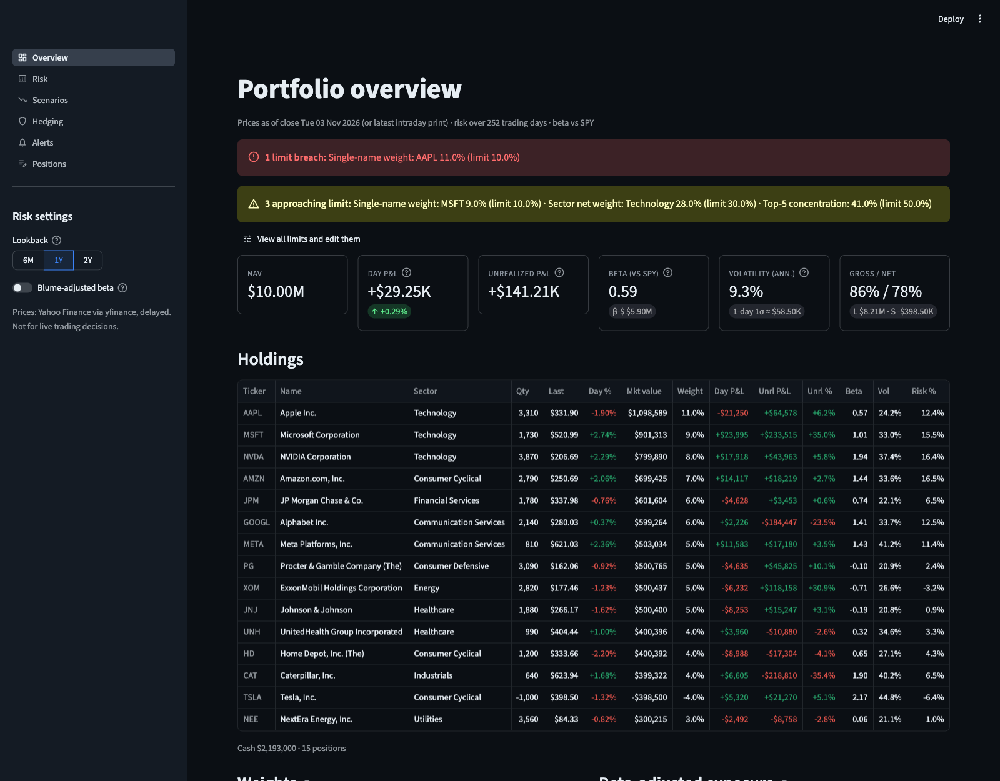
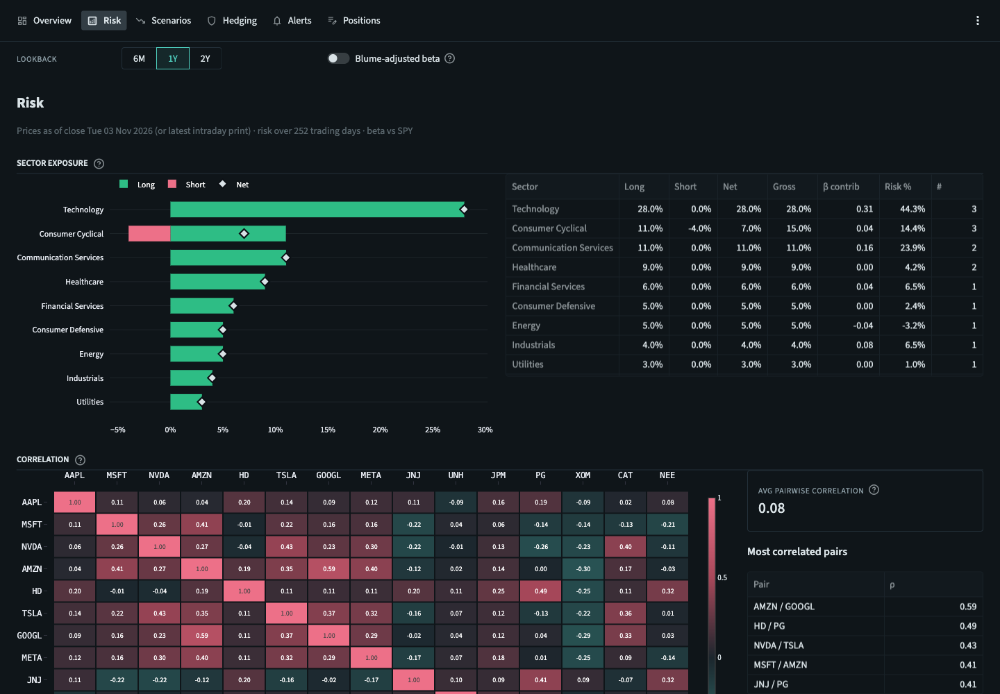
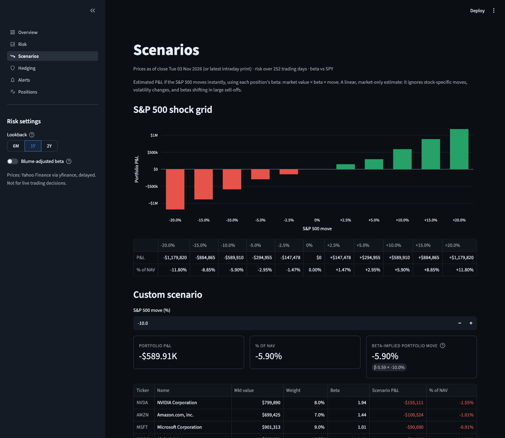
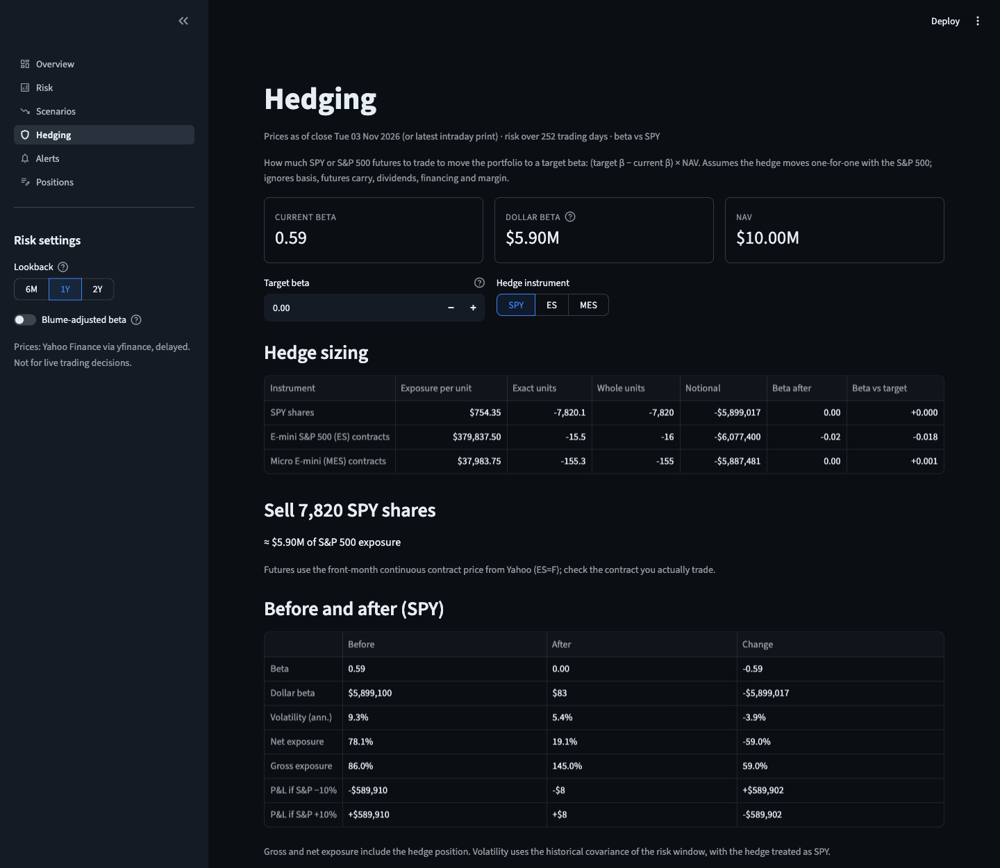
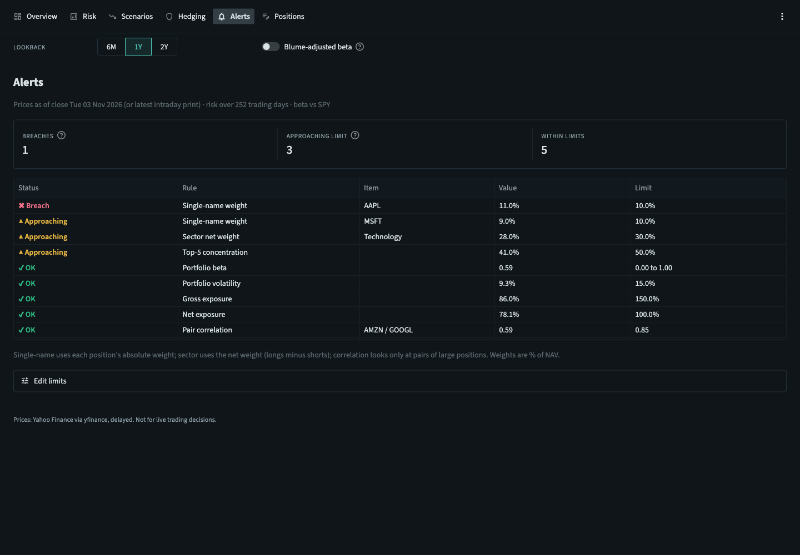

# Equity Risk Dashboard

[](https://github.com/simonchen0/Equity-Risk-Dashboard/actions/workflows/ci.yml)

An interactive risk dashboard for a long/short equity portfolio, inspired by the tools used on institutional equity trading desks. Add positions, see market value and P&L, measure beta, volatility, correlation and sector exposure, stress the book against S&P 500 moves, size an index hedge, and get flagged when the portfolio breaches risk limits.



## Features

- **Portfolio management.** Long and short positions plus a cash balance, edited in the app or imported and exported as CSV. Market value, NAV, weights, gross/net exposure, day and unrealized P&L.
- **Risk analytics.** Portfolio and per-position beta vs SPY (raw or Blume-adjusted), annualized volatility, each position's share of portfolio risk, a sector-grouped correlation heatmap, and long/short/net sector exposure.
- **Scenario analysis.** Portfolio P&L for S&P 500 moves from −20% to +20%, plus a custom move with a per-position breakdown.
- **Hedging calculator.** Enter a target beta and get the SPY shares or ES/MES futures contracts to trade, the beta left over from whole-unit rounding, and before/after beta, volatility, exposure and scenario P&L.
- **Risk alerts.** Configurable limits (single-name, sector, top-5 concentration, beta band, volatility, gross/net exposure, correlated pairs) shown as OK / approaching / breach.

| Risk | Scenarios |
|---|---|
|  |  |

| Hedging | Alerts |
|---|---|
|  |  |

## Run it

Requires [uv](https://docs.astral.sh/uv/) (it installs Python 3.12 for you).

```bash
uv sync
uv run streamlit run app/streamlit_app.py
```

The app opens with a demo portfolio (about $10M, 14 longs and 1 short, built from real prices). Market data comes from Yahoo Finance and needs an internet connection.

```bash
uv run pytest          # unit tests (offline, no market data needed)
uv run ruff check .    # lint
```

## Using your own portfolio

On the **Positions** page, edit the table directly or upload a CSV:

```csv
ticker,quantity,avg_cost,sector
AAPL,3000,150.00,
TSLA,-500,250.00,
CASH,100000,,
```

- Positive quantity is long, negative is short. `avg_cost` and `sector` are optional (`avg_cost` is needed for unrealized P&L; `sector` overrides Yahoo's classification).
- Cash is a row with ticker `CASH`.
- Invalid rows are reported by row number instead of being silently dropped.

Your portfolio, alert limits, lookback and Blume setting are saved automatically to `~/.config/riskdash/state.json` and restored the next time you open the app. "Reset to demo portfolio" and "Reset to defaults" overwrite the saved copy. Set `RISKDASH_STATE_FILE` to use a different file, or `RISKDASH_PERSIST=0` to turn saving off (do this on a shared or public deployment, where one file would be shared by every visitor).

Alert limits default to `config/default_limits.yaml` and can be edited per session on the **Alerts** page. The defaults are illustrative, not recommendations.

## How it works

The calculations live in `src/riskdash/` with no UI or network code, so they are tested on their own with synthetic prices and hand-computed answers. The Streamlit app in `app/` only loads data, calls the engine and renders the results.

```
src/riskdash/
  data/        market data providers (Yahoo, test fixtures) and a disk cache
  portfolio/   positions, CSV import/export, valuation
  analytics/   returns, beta, volatility, correlation, exposure, scenarios, hedging
  alerts/      limits and the rules that evaluate them
  engine.py    ties data, valuation and risk into one snapshot
  persistence.py  save/restore of portfolio and settings (one local JSON file)
app/           Streamlit pages and shared components
config/        default risk limits
tests/         unit tests
```

Key assumptions, in brief (full definitions are in [SPEC.md](SPEC.md)):

- Beta is the regression slope of daily returns on SPY over the selected window (6M, 1Y or 2Y). Volatility is annualized with √252 from the sample covariance of the same window.
- Scenario P&L is `market value × beta × S&P move`. It is a linear, market-only estimate.
- Hedge size is `(target beta − current beta) × NAV`, assuming the hedge moves one-for-one with the S&P 500.

## Limitations

- Prices come from Yahoo Finance through `yfinance`, an unofficial API: data is delayed and can be rate-limited. If Yahoo is unavailable the app shows the most recently cached prices and says so.
- Betas, volatilities and correlations are historical estimates, not forecasts, and they move over time.
- Scenarios ignore stock-specific moves and betas changing in large sell-offs.
- Hedging ignores basis, futures carry, dividends, financing and margin. Futures use Yahoo's front-month continuous contract price (`ES=F`).
- US equities in USD only. Yahoo's sectors are close to, but not the same as, GICS.
- Not for live trading decisions.
